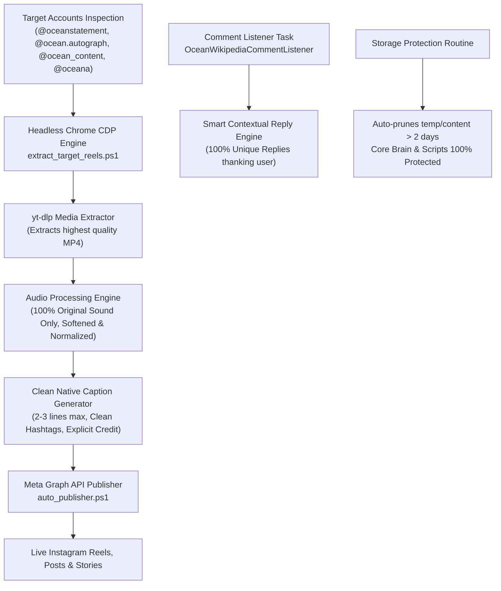

# Ocean Wikipedia Engine — Architecture & Operational Playbook

## 1. System Overview
The **Ocean Wikipedia (@oceanwikipedia)** automation engine runs a 100% autonomous pipeline without manual user input.

---

## 2. Instagram Stories & Engagement Engine
- **Endpoint:** `POST /{ig-user-id}/media` with `media_type = STORIES`
- **Publish:** `POST /{ig-user-id}/media_publish`
- **Supported Media:** 9:16 vertical images and MP4 videos
- **Verified Live Publication:** Successfully tested and verified live with ID `18067590716789784`.

---

## 3. Strict Operating Rules
1. **Audio Integrity:**
   - Strictly **NO artificial AI voiceovers** (rejected by user as unnatural/underwater sounding).
   - Strictly **NO synthetic surface ocean wave loops**.
   - Always retain the **original authentic video sound**, softened to `volume=0.85` with smooth 2-second audio fade-out.
2. **Caption Formatting:**
   - Short and concise (2-3 natural sentences).
   - 100% native fluent English.
   - Strictly **NO weird signs or bullet emojis** (`🔹`, `💾`, `↗️`).
   - Clean, focused hashtags (5-7 tags).
   - Explicit creator credit line: `Credit: @handle`.
3. **Storage & Safety:**
   - Temporary media in `temp/` and `content/` older than 2 days are cleaned automatically.
   - Core Brain files (`*.ps1`, `*.py`, `*.json`, `*.md`) are permanently protected.
